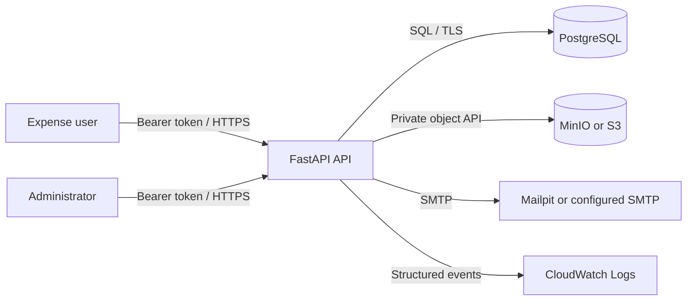
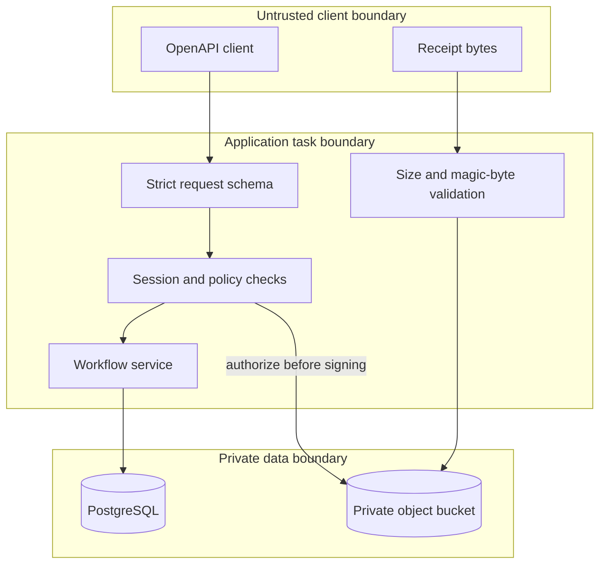
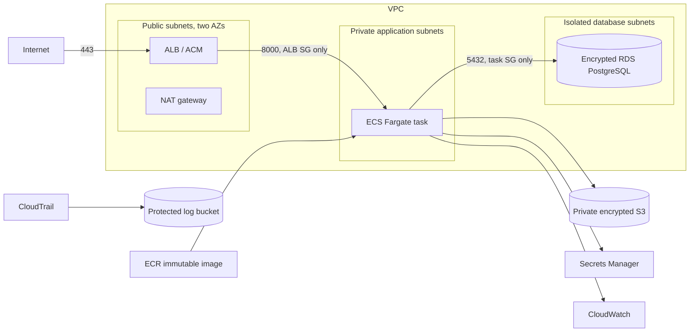

# Architecture

## Application Context

The API is the sole public application entry point. It authenticates a hash-only opaque session,
loads an active user, applies centralized role and ownership policies, executes a transaction, and
records the sensitive action. Public UUIDs are identifiers, not authorization controls.

## Local Data Flow And Trust Boundaries

Receipt uploads are streamed to bounded temporary storage. The application ignores claimed MIME
type, detects supported content, hashes it, assigns an unpredictable key, uploads it privately, and
persists metadata. On database failure it deletes the new object. Downloads require a fresh object
authorization check before issuing a 60-second attachment URL.

## AWS Deployment

The lab profile intentionally uses one NAT gateway, one task, and single-AZ RDS to constrain cost.
A production profile requires one NAT per AZ or approved endpoints, at least two tasks, Multi-AZ
RDS, deletion protection, tested backup restoration, alert routing, and operational SMTP.

## Architecture Decisions

- Opaque sessions were selected over JWTs so logout, deactivation, and password-reset revocation are
  immediate and authorization state never becomes a stale client claim.
- Uploads pass through the API rather than direct presigned upload so size and content checks happen
  before an object becomes available.
- User-controlled schemas cannot contain `owner_id`, `role`, or `state`; workflow transitions are
  commands with database row locks.
- CORS is disabled because this sprint has no browser SPA. Introducing one requires an explicit
  origin, browser token-storage design, and CSRF analysis.

